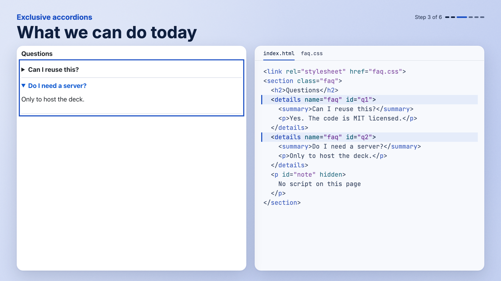

# Live-ish

Live-ish coding: now with 100% less typing in front of strangers.

Live-ish runs slides and scripted demos of code and UI from one web app. Each click plays one step in a real page and highlights the code behind it.

> Preview. Packages are not on npm yet. The API will change. You can [play the starter deck][live] in your browser.



## Quick start

The packages are not on npm yet, so `pnpm create live-ish` fails today. Until they are, [run it from this repo](#run-it-from-this-repo). Once they are, this is the whole setup:

```sh
pnpm create live-ish my-talk
cd my-talk
pnpm dev
```

You need Node 22 or later and pnpm. Open <http://localhost:3000/present> and press the right arrow key to play the demo. Press `s` to open the speaker window.

## Run it from this repo

This runs the starter deck from `examples/starter`, and works today. You need Node 22 or later. The repo pins pnpm through Corepack.

```sh
git clone https://github.com/bpainter/live-ish-coding-demos.git
cd live-ish-coding-demos
corepack enable
pnpm install
pnpm --filter starter dev
```

Then open the same address as above. The `pnpm live-ish` commands below run from a deck's folder, so in this repo, run `cd examples/starter` first.

## Slide types

| Type          | Shows                                                                                 | Create one                              |
| ------------- | ------------------------------------------------------------------------------------- | --------------------------------------- |
| Copy          | Text and images                                                                       | `pnpm live-ish new copy "My point"`     |
| Web demo      | An HTML, CSS and JavaScript demo with code, callouts and steps, on one page or as two | `pnpm live-ish new web-demo tabs`       |
| Terminal demo | Recorded commands with their code                                                     | `pnpm live-ish new terminal-demo setup` |

## Themes

<!-- themes:start: generated by scripts/gen-readme.mts -->

Demo slides use one of 10 themes: glass, flat, early web, soft, brutalist, layered, tactile, phosphor, Swiss and high contrast. Set one for a deck, a demo or a page:

<!-- themes:end -->

```ts
// deck.config.ts
import { defineDeck } from "@live-ish/engine/config";

export default defineDeck({
  // ...
  chrome: { theme: "flat" },
});
```

The speaker window keeps one fixed style. You can add your own theme as a token file. See [themes][themes].

## AI tools

New decks include instructions and skills for coding agents. Your agent can add slides and run `live-ish check`. It runs in your own Claude or Codex app or CLI, so this repo needs no API key. See [AI tools][ai-tools], and the [instructions a deck gets](packages/engine/templates/agents/AGENTS.md). You can use Live-ish with no AI tool.

## Presenting

Run `pnpm live-ish present` to serve the deck from your laptop. It needs no network after install. See [presenting][presenting].

## Docs

- [Getting started][start]
- [Write a web demo][web-demos]
- [Deploy a deck][deploy]
- [Known limits][limits]

<!-- Every docs link in this file uses these references. -->

[live]: https://live-ish.vercel.app/live
[start]: https://live-ish.vercel.app/start
[web-demos]: https://live-ish.vercel.app/web-demos
[deploy]: https://live-ish.vercel.app/deploy
[limits]: https://live-ish.vercel.app/limits
[themes]: https://live-ish.vercel.app/themes
[ai-tools]: https://live-ish.vercel.app/ai-tools
[presenting]: https://live-ish.vercel.app/presenting

## Contributing

Read [CONTRIBUTING.md](CONTRIBUTING.md) to set up the repo and run the tests.

## License

[MIT](LICENSE).

Start with the [quick start](#quick-start).
